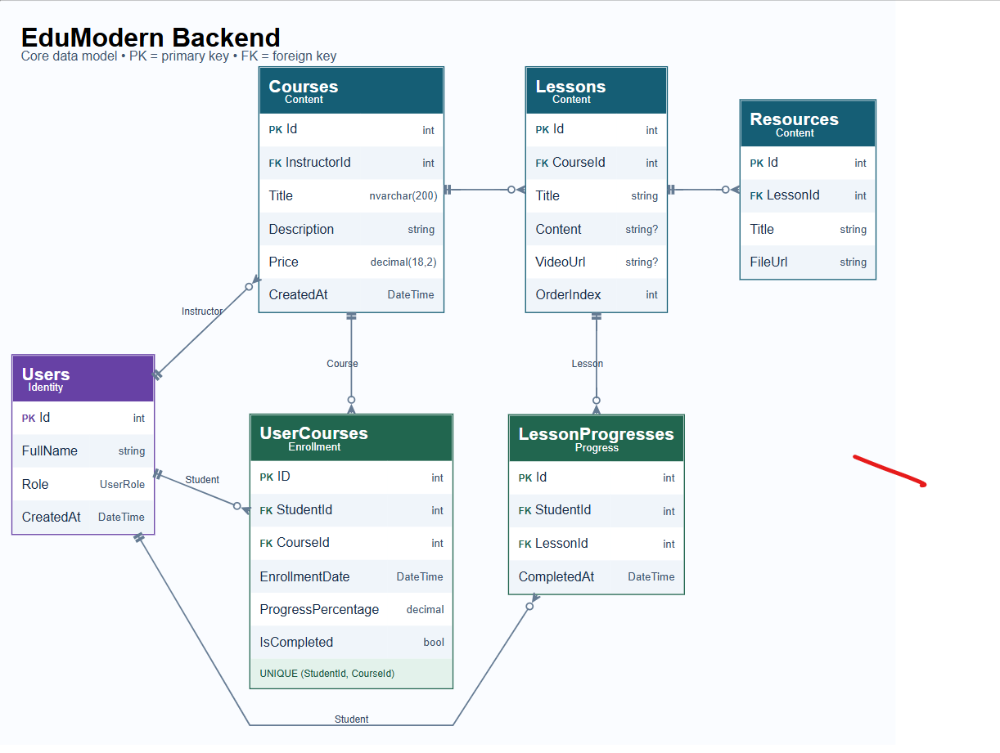

# EduModern Backend

EduModern is an AI-assisted course platform. This ASP.NET Core Web API manages users, courses, lessons, enrollments, and lesson progress. It uses SQL Server for persistence and Gemini to answer questions using lesson transcripts.

[Live demo](https://edu-modern-alpha.vercel.app/) · [Frontend repository](https://github.com/Marwan-Essam55/EduModern-Front)

## How lessons and AI chat work

1. A multipart request to `POST /api/Lessons/AddLesson` uploads a video to Cloudinary. The API derives an MP3 URL from the uploaded video URL, submits it to AssemblyAI, and stores the resulting transcript in `Lesson.Content`.
2. `POST /api/Chat/Ask` accepts `lessonId` and `question`. It rejects blank questions and blank transcripts and returns 404 for an unknown lesson. The server uses the saved transcript for context and prompts Gemini to answer in the language of the question.
3. The API returns one JSON response with an `answer` field. Each request is independent. The browser keeps the visible conversation in memory, and the API receives no conversation history.

Personal notes are a React scratchpad. The frontend keeps text in component state and exports `Lesson_Notes.txt` in the browser. The API has no personal-note storage or synchronization endpoint. Lesson resources are separate records, and the current resource upload action saves a placeholder URL.

## API access

ASP.NET Core Identity manages accounts and passwords. Login issues a three-hour JWT signed with HS256. The JWT role claim comes from the stored `User.Role` enum. Send the token as `Authorization: Bearer <token>` to authenticated endpoints.

| Access required | Endpoints and behavior |
| --- | --- |
| Public | Student registration and login, course listing and detail, course update, and lesson chat. `Chat/Ask` has an action-level `AllowAnonymous` override. |
| Any authenticated user | List or add lessons, list lesson resources, create or delete courses, and mark lessons complete. These actions use a general authentication requirement. |
| Student | Enroll through `POST /api/Courses/Enroll/{courseId}` and list enrollments through `GET /api/Courses/MyCourses`. |
| Instructor or Admin | Submit lesson resource records through `POST /api/Resources/Upload`. |
| Admin | List users through `GET /api/Admin/Users`, register instructors through `POST /api/Admin/RegisterInstructor`, and add staff through `POST /api/Auth/AddStaff`. |

`RegisterInstructor` assigns the Identity `Instructor` role but leaves the separate `User.Role` field at its default (`Admin`). The admin user list reads Identity roles. `AddStaff` sets the enum used by login (`0` Admin, `1` Instructor, `2` Student). See the [use-case diagram](docs/images/use-cases.png) for the main API flows.

## Architecture

| Path | Responsibility |
| --- | --- |
| [Backend/Program.cs](Backend/Program.cs) | Registers controllers, SQL Server, Identity, JWT authentication, CORS, and integration services. |
| [Backend/Controllers](Backend/Controllers) | HTTP routes, authorization attributes, and course, lesson, account, and progress workflows. |
| [Backend/Services](Backend/Services) | Cloudinary video uploads, AssemblyAI transcription, and Gemini requests. |
| [Entities-Models](Entities-Models) | EF Core entities, the Identity-backed database context, and migrations. |

## Data model

Courses belong to instructors and contain ordered lessons. Enrollment and lesson-progress records connect users to courses and lessons. Lesson resources store attachment metadata and a URL. The diagram shows the core domain tables.



## Run locally

You need the .NET 10 SDK and a SQL Server instance. The API project currently references `../../project1/project1/project1.csproj`, a path outside this checkout. In a standalone clone, change that `ProjectReference` in [Backend/WebApplication1.csproj](Backend/WebApplication1.csproj) to `../Entities-Models/project1.csproj` in your local copy before restoring.

Set the following environment variables in the shell that will run the API. Use your own credentials.

| Variable | Value |
| --- | --- |
| `ConnectionStrings__connectionString` | SQL Server connection string for the development database. |
| `Jwt__Issuer`, `Jwt__Audience` | Issuer and audience for development tokens. |
| `Jwt__Key` | A private signing key with at least 32 bytes. |
| `Gemini__ApiKey` | Gemini API key for lesson chat. |
| `CloudinarySettings__CloudName`, `CloudinarySettings__ApiKey`, `CloudinarySettings__ApiSecret` | Cloudinary credentials for video uploads. |
| `AssemblyAI__ApiKey` | AssemblyAI API key for transcript generation. |

From the repository root, restore the projects and apply the checked-in migrations to the development database. Install the matching EF Core CLI if it is missing. Use a database with course and lesson data to try the learning flows. The application does not seed accounts or sample courses on startup.

```sh
dotnet restore Backend/WebApplication1.csproj
dotnet tool install --global dotnet-ef --version 10.0.12
dotnet ef database update --project Entities-Models/project1.csproj --startup-project Backend/WebApplication1.csproj
dotnet run --project Backend/WebApplication1.csproj --launch-profile http
```

Open `http://localhost:5278/` to check that the API is running. Set the frontend's `VITE_API_URL` to `http://localhost:5278` when using this HTTP profile.
